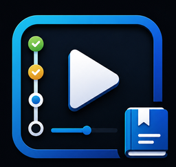
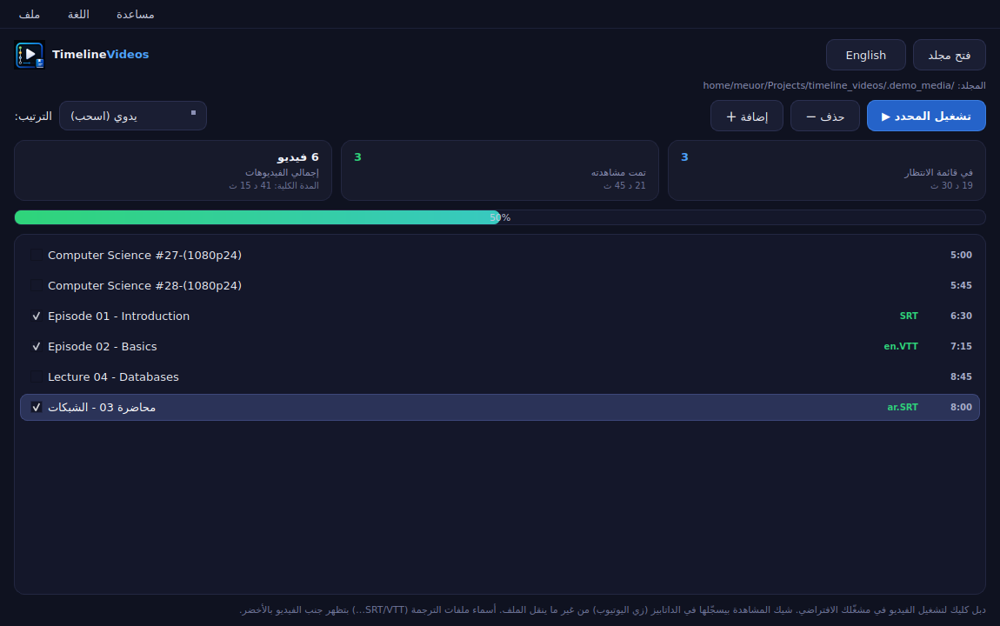
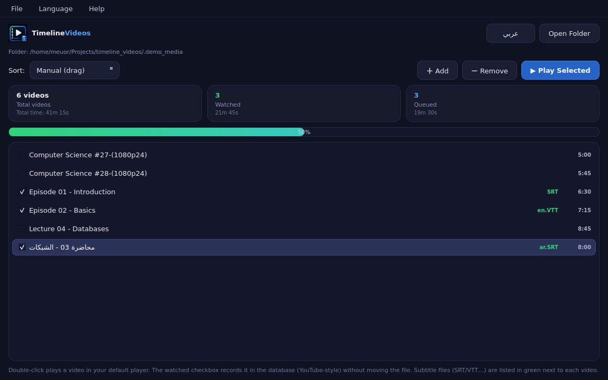
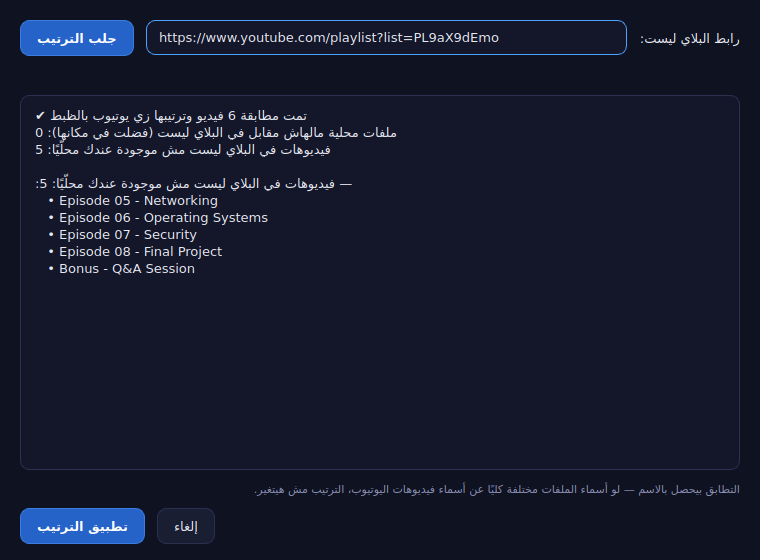

<div align="center">
  
  <h1>Timeline Videos</h1>
  <p>
    <b>مدير قوائم فيديو ثنائي اللغة (عربي / إنجليزي)</b><br>
    A <b>bilingual (Arabic/English) playlist manager</b> that tracks what you
    watched — YouTube-style — <b>without ever moving your video files</b>.
  </p>
  <p>
    
    
    
    
    
    
    
  </p>
</div>

<p align="center">
  
</p>
<p align="center"><i>↑ الواجهة العربية (RTL) — الافتراضي / the default Arabic interface</i></p>

It doesn't play video itself — double-clicking a video (or **Play
Selected**) launches it in whatever the OS has set as the default
player (MPV, VLC…), exactly like double-clicking it in the file
manager. Watched status lives in a small SQLite database stored
**next to the videos**.

---

## 📦 Installation

### ✔️ Official way — APT repository (Debian / Ubuntu)

The project ships its own **GPG-signed APT repository**, so `apt`
installs and updates it like any Debian package:

```bash
# 1. add the repository signing key
curl -fsSL https://ragaeidos.github.io/TimelineVideos/key.gpg | \
    sudo gpg --dearmor -o /usr/share/keyrings/timeline-videos.gpg

# 2. add the repository
echo "deb [signed-by=/usr/share/keyrings/timeline-videos.gpg] https://ragaeidos.github.io/TimelineVideos/ ./" | \
    sudo tee /etc/apt/sources.list.d/timeline-videos.list

# 3. install
sudo apt update && sudo apt install timeline-videos
```

Future versions arrive like any other package:

```bash
sudo apt update && sudo apt upgrade timeline-videos
```

> **Package notes**
> - **Architecture: all** — one package for every Debian/Ubuntu
>   derivative (x86_64, ARM…).
> - `ffmpeg` (durations) and `yt-dlp` (YouTube playlist import) are
>   installed automatically as apt *Recommends*.
> - `ftfy` + `wcwidth` are **bundled inside the package** (Debian
>   doesn't ship ftfy), so garbled-title repair works out of the box.
> - If your distro's yt-dlp is too old for YouTube:
>   `pip install -U yt-dlp`.

*Why not Debian's own repositories?* Reaching the official repos
means filing an ITP bug, passing the NEW queue and Debian Policy
review, and maintaining the package long-term — a process meant for
software with a wide audience. This signed repo gives users the exact
same `apt install` / `apt upgrade` experience in the meantime.

### 📥 Other ways

| Method | How |
|---|---|
| **Direct `.deb`** | Download from the [Releases page](https://github.com/RaGAEIDOS/TimelineVideos/releases/latest), then `sudo apt install ./timeline-videos_*.deb` |
| **Build it yourself** | `./build_deb.sh` → `dist/deb/timeline-videos_2.1-1_all.deb` |
| **From source (Linux)** | `./run.sh` (creates `.venv` on first run) |
| **Windows** | `python main.py` — or build an EXE with `build_windows.bat` |
| **App menu** (source installs) | `cp timeline-videos.desktop ~/.local/share/applications/` |

---

## ✨ Features

- **📁 File > Open Folder** — opens a folder as its own separate
  workspace. Its playlist, order, and watched state are all stored
  inside that folder itself (a hidden `.timeline_videos.db`), so
  reopening it later restores everything exactly as you left it, and
  different folders never mix. The last folder reopens automatically
  on startup.
- **🌐 Arabic / English** — one-click switch from the header button or
  the Language menu; Arabic flips the whole layout to RTL. The
  choice is remembered.
- **🎨 Modern dark theme** — layered cards, accent colors, rounded
  corners, YouTube-style progress bar.
- **⏳ Loading screen** — heavy startup work (UI imports, database,
  folder scan, tool checks) runs behind a splash screen, so the app
  never freezes at launch.
- **📊 Summary bar** — total videos + total duration, watched count &
  time, queued count & remaining time, and a watched-ratio progress
  bar.
- **🔢 Advanced sorting** — by number after `#` (e.g. `…Computer
  Science #28-(1080p24)` sorts by `28`, ignoring the resolution
  tag), by the last number in the title, natural name order, file
  size, date added, last played — plus manual drag-and-drop
  (choosing drag sets the sort back to "Manual").
- **📺 YouTube playlist order** — paste a YouTube playlist link
  (Ctrl+Y): the playlist is fetched as JSON via `yt-dlp`, matched to
  your local files by title, and the list is reordered **exactly
  like the YouTube playlist**. Unmatched files keep their place;
  playlist videos you don't have are listed in the summary.
- **✅ Watched tracking, YouTube-style** — opening a video records it
  as watched, stamps the last-played time and bumps a play counter
  (all in the database; the file stays where it is). The checkbox
  and the right-click menu toggle watched manually anytime.
- **🟢 Subtitle files shown per video** — every subtitle file sitting
  next to a video is listed in green on its row: plain names show
  as `SRT` / `VTT`, language-tagged yt-dlp names show as
  `ar.SRT`, `en.VTT`… The video's duration appears on the row too
  (read once with `ffprobe`, then cached in the database).
- **System tray** — closing the window minimizes to the tray;
  right-click the tray icon for Show/Exit.

## 🖼️ Screenshots

**English interface (LTR):**

<p align="center">
  
</p>

**YouTube playlist import (Ctrl+Y):**

<p align="center">
  
</p>

---

## ▶️ Running from source

**Requirements**

- Python 3.10+
- `ffprobe` (for durations): `sudo apt install ffmpeg`
- `yt-dlp` (for YouTube playlist import): installed automatically
  into the app's virtualenv by `run.sh`

```bash
pip install -r requirements.txt   # PyQt5, ftfy, yt-dlp
./run.sh                          # Linux — creates .venv on first run
python main.py                    # Windows / manual
```

## 📁 Project layout

```
video_player/
├── main.py                # entry point: theme + splash + startup worker
├── main_window.py         # PyQt5 UI: header, toolbar, stats bar,
│                          #   playlist, tray, delegate, probe thread
├── playlist_manager.py    # data layer: sorting, watched tracking,
│                          #   stats, legacy JSON migration
├── video_db.py            # SQLite database (stored per folder)
├── media_probe.py         # ffprobe duration + file size
├── youtube_import.py      # yt-dlp playlist JSON + title matching
├── youtube_dialog.py      # playlist import dialog (background fetch)
├── splash.py              # loading screen + startup worker thread
├── i18n.py                # Arabic/English translations + RTL + formats
├── theme.py               # modern dark QSS stylesheet
├── external_player.py     # opens files via xdg-open (Linux) / default app
├── resources.py           # asset paths (source or PyInstaller-frozen)
├── assets/
│   ├── logo.ico           # app / window / tray icon
│   └── icon_mark.png      # header thumbnail
├── screenshots/           # README screenshots
├── run.sh                 # Linux launcher (builds .venv on first run)
├── build_linux.sh         # Linux PyInstaller builder → dist/TimelineVideos
├── build_deb.sh           # Debian package builder → dist/deb/*.deb
├── make_apt_repo.sh       # signed APT repo (GitHub Pages) → deb_repo/
├── build_windows.bat      # Windows PyInstaller builder → .exe
├── timeline-videos.desktop# app-menu entry for Linux desktops
├── .gitignore
├── requirements.txt
└── video_player.spec      # PyInstaller build config
```

## 🧰 Building & packaging

- **Linux binary**: `./build_linux.sh` → `dist/TimelineVideos`
- **Windows EXE**: double-click `build_windows.bat` (must run on
  Windows — PyInstaller can't cross-compile). The exe keeps the
  Timeline Videos icon in Explorer, the taskbar, and the tray.
- **Debian package**: `./build_deb.sh` → `dist/deb/*.deb`

**Maintainer note — publishing a new version to the APT repo:**

```bash
./build_deb.sh                            # build dist/deb/*.deb
GPG_KEY=<fingerprint> ./make_apt_repo.sh   # rebuild deb_repo/ (signed)
# commit the new deb_repo/ contents to the gh-pages branch and push
```

## 💾 How tracking data is stored

- Each opened folder gets a hidden `.timeline_videos.db` (SQLite)
  **inside the folder** — playlist order, watched flags, play
  counts, last-played times, sizes, and durations. Move the folder
  and everything travels with it; delete the file and the folder is
  simply re-scanned fresh.
- The default list (no folder opened) lives in
  `~/.simple_video_player/playlist.db`.
- **Old versions** of the app (which used a `.timeline_videos.json`
  file and moved watched files into a `Watched` subfolder) are
  migrated automatically on first open: the JSON playlist is
  imported into the database and the JSON file is kept untouched as
  a backup. Files that were already moved into `Watched/` stay
  where they are — the app just keeps tracking them.
- **Folders moved between machines** (e.g. `E:\…` on Windows →
  `/mnt/…` on Linux) are handled automatically: rows whose old
  paths no longer exist are matched to the videos actually in the
  folder by file name and re-pointed (or merged into an existing
  row, keeping watched/play history) — no more duplicate entries
  after copying a library to another OS.

## 🔤 Notes on garbled (mojibake) titles

Some downloaded videos (especially Arabic titles) end up with
filenames mangled by an encoding mismatch. Both the common
Windows-1252 style (fixed by `ftfy`) and the Arabic Windows-1256
style (detected by its signature and reversed) are auto-repaired
the moment a title is loaded. Correct titles are left untouched.
This only fixes the displayed title — the file on disk keeps its
original name.

## 🎯 Credits

Developed by **رجائي (Ragaey)** — Alexandria, Egypt.
Play. Learn. Track. Grow.
